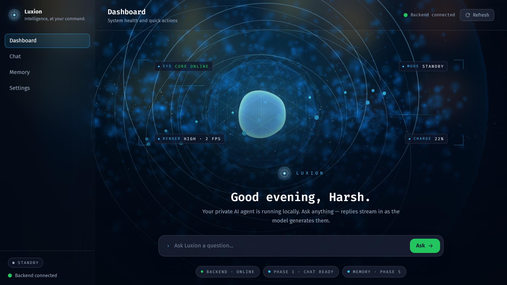
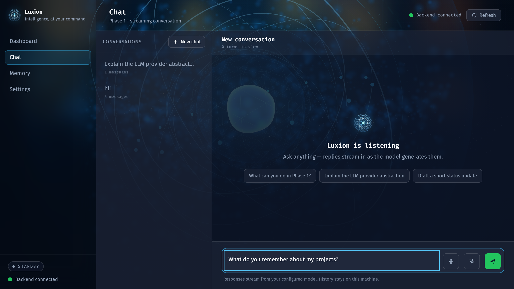
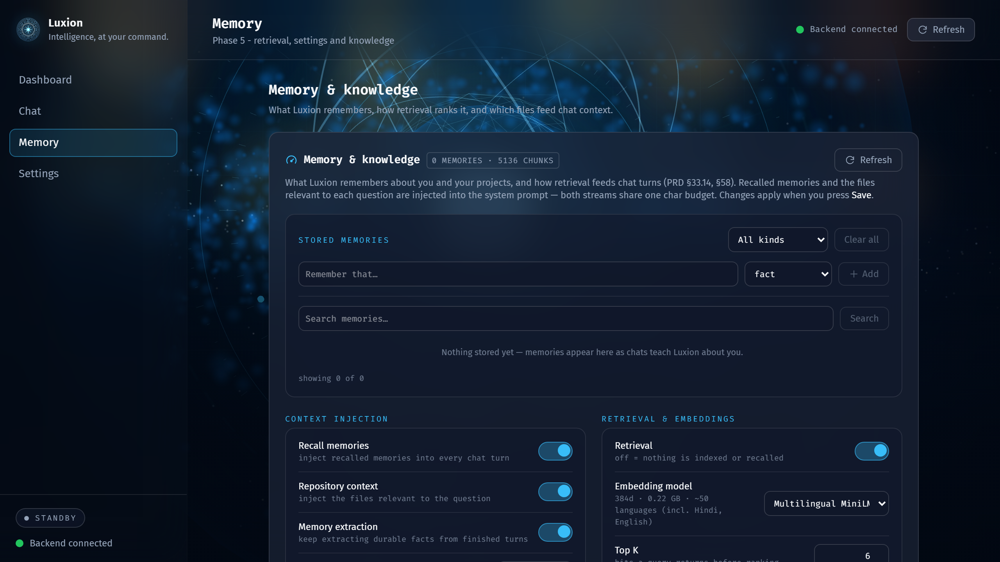
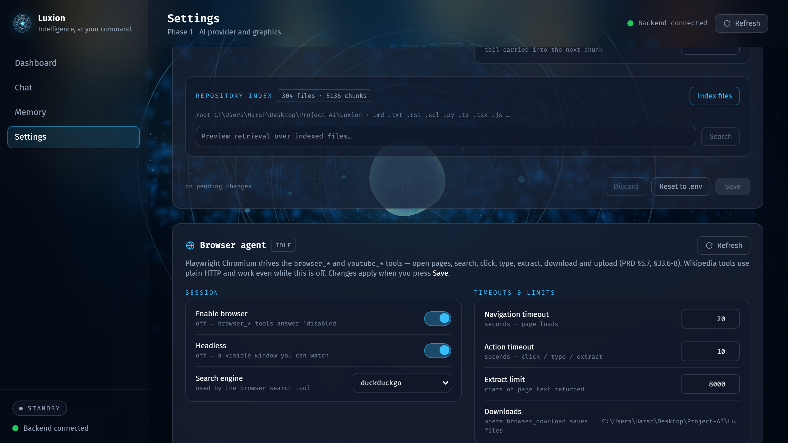
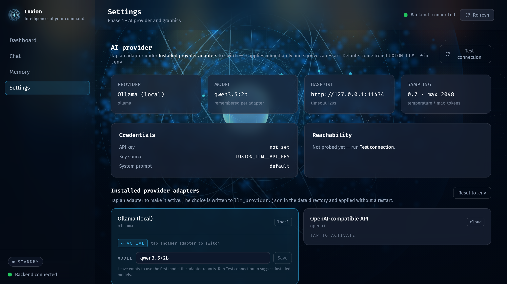

<p align="center">
  
</p>

<h1 align="center">Luxion</h1>

<p align="center">
  <b>Personal AI agent for Windows</b> — local-first, tool-based, multimodal.<br/>
  You describe what you want; Luxion figures out how to do it.
</p>

<p align="center">
  
  
  
  
  
  
  
</p>

<p align="center">
  <a href="#demo">Demo</a> ·
  <a href="#screenshots">Screenshots</a> ·
  <a href="#what-luxion-does-today">Features</a> ·
  <a href="#quick-start">Quick start</a> ·
  <a href="#roadmap">Roadmap</a>
</p>

---

## Demo

A 22-second tour of the running app — Dashboard → Chat → Memory → Settings
(real capture, no mocks):

<p align="center">
  <video src="docs/assets/demo.webm" controls muted loop playsinline width="820" poster="docs/assets/dashboard.png">
    Your browser does not support the video tag — see <a href="docs/assets/demo.webm">demo.webm</a>.
  </video>
</p>

## Screenshots

| Dashboard | Chat |
|:---------:|:----:|
|  |  |

| Memory & knowledge | Settings → Browser agent |
|:------------------:|:------------------------:|
|  |  |

<details>
<summary><b>More of Settings</b> — providers, permissions, voice, graphics</summary>



</details>

## What Luxion does today

Everything below is **shipped and tested** (Phases 0–6):

- **Chat that acts** — streaming replies with a 26-tool agent loop: files,
  web, memory, repository search, browser automation, voice, and more, gated
  by an autonomy matrix with confirmations and an audit log.
- **Memory that compounds** — durable facts, preferences and tasks are
  extracted from finished turns, ranked by hybrid vector + keyword recall,
  and injected into every future prompt.
- **Repository knowledge** — indexes your project files (chunked, embedded,
  SQLite-vec) so `search_code` and chat answers start from *your* code.
- **Browser agent** *(new)* — a Playwright-driven Chromium can open pages,
  search, click, type, extract, download and upload; plus YouTube
  (search / open / play / pause / seek / volume) and Wikipedia
  (search + article summaries over plain HTTP).
- **Voice** — wake word, push-to-talk, streaming STT (faster-whisper),
  TTS replies, barge-in while speaking.
- **Your models, your machine** — Ollama by default (fully offline),
  OpenRouter or any OpenAI-compatible endpoint; tap-to-switch in Settings
  without a restart.
- **Permission layers** — OS privacy probes → app consents → account sources
  → per-tool risk engine. A denied mic or screen really does block the tool.
- **Local-first** — SQLite, files on disk, secrets only in `.env`. Nothing
  leaves the machine unless a cloud provider is explicitly selected.

## Stack

| Layer | Tech |
|-------|------|
| Desktop shell | Tauri 2 (Rust) — `frontend/src-tauri/` |
| Frontend | React 19 · TypeScript · Vite 8 · Tailwind 4 · three.js — `frontend/` |
| Backend | Python ≥3.11 · FastAPI · SQLAlchemy · Alembic · Playwright — `backend/` |
| Memory + RAG | SQLite (+ sqlite-vec) · fastembed · hybrid retrieval |
| Local AI | Ollama (default) · OpenRouter · OpenAI-compatible |
| Voice | faster-whisper STT · pyttsx3 / OmniVoice TTS · openwakeword |

## Quick start

```powershell
# 0. Config — copy .env.example to .env and edit (all vars prefixed LUXION_)
copy .env.example .env

# 1. Backend  -> http://127.0.0.1:8756
cd backend
python -m venv .venv
.\.venv\Scripts\pip.exe install -e ".[dev]"
.\.venv\Scripts\python.exe -m luxion

# 2. Frontend -> http://localhost:5173   (new terminal)
cd frontend
npm install
npm run dev

# …or both at once:
.\scripts\dev.ps1

# Desktop window
cd frontend
npx tauri dev
```

The browser agent needs Chromium once:

```powershell
cd backend
.\.venv\Scripts\python.exe -m playwright install chromium
```

## Repository layout

```
Luxion/
├── prd.md                  # Product requirements (source of truth)
├── memory.md               # Project memory — updated after every phase
├── docs/assets/            # README screenshots + demo clip
├── design-system/luxion/   # Persisted design system (ui-ux-pro-max skill)
├── .opencode/skills/       # Agent skills (ui-ux-pro-max, …)
├── backend/                # Python API + agent core
│   ├── luxion/             # app, config, database, logging, api
│   │   ├── browser/        # Playwright session manager (Phase 6)
│   │   ├── context/        # context assembly (tokens, budget, injection)
│   │   ├── llm/            # provider adapters (ollama, openrouter, mock)
│   │   ├── memory/         # memory store, extraction, recall
│   │   ├── rag/            # chunking, embeddings, sqlite-vec store
│   │   ├── repository/     # workspace scan, index, code retrieval
│   │   ├── tools/          # tool framework + 26 builtins
│   │   └── voice/          # mic, STT, TTS, wake word
│   ├── alembic/            # migrations
│   └── tests/              # pytest suite (484 tests)
├── frontend/               # React app + Tauri shell
│   ├── src/                # UI (dashboard, chat, memory, settings)
│   └── src-tauri/          # Tauri 2 (crate `luxion`)
└── scripts/dev.ps1         # runs backend + frontend together
```

## Tests & checks

```powershell
cd backend
.\.venv\Scripts\pytest.exe        # 484 tests (1 skipped)
.\.venv\Scripts\ruff.exe check .  # lint
.\.venv\Scripts\ruff.exe format --check .

cd ..\frontend
npm run build                     # tsc + vite
npm run lint                      # oxlint
```

## Current status

**Phases 0–6 complete** — architecture; streaming chat + provider adapters
(Ollama / OpenRouter / OpenAI-compatible, tap-to-switch); context manager;
tool framework with 26 built-ins, autonomy matrix, confirmations and audit
log; capabilities & consent (OS probe, app consents, risk engine); voice
(STT, TTS, wake word, barge-in); memory store + RAG index + context
injection; repository indexing + `search_code`; **browser agent**
(Playwright tools + YouTube + Wikipedia). See [memory.md](memory.md) for the
full phase log.

## Roadmap

| | Phase | Status |
|--|-------|--------|
| ✅ | 0–6 | Architecture → browser agent (see above) |
| ⬜ | 7 | Computer Automation |
| ⬜ | 8 | Coding Agent |
| ⬜ | 9 | Web Intelligence |
| ⬜ | 10 | Communication |
| ⬜ | 11 | Vision + Hardware |
| ⬜ | 12 | 3D Orb (interaction & behaviour) |
| ⬜ | 13 | Advanced Agent |

## Docs

- [`prd.md`](prd.md) — full requirements (source of truth)
- [`memory.md`](memory.md) — living status log, phase notes, gotchas
- [`design-system/luxion/MASTER.md`](design-system/luxion/MASTER.md) — UI design rules
